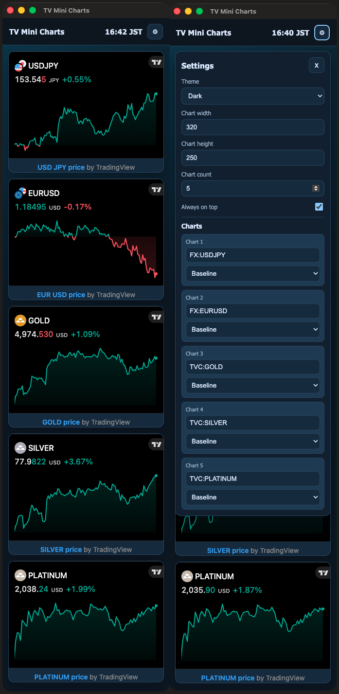
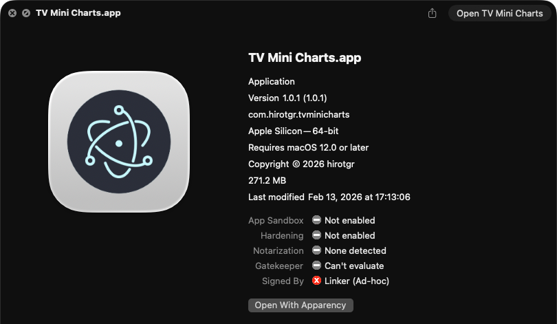

Electronアプリ作成練習のためにGPT-5.3-Codexで作ったTradingViewのミニチャートを表示するだけのアプリ

 

## 依存関係の監査備忘録

`electron-builder@26.18.0` のビルド依存 `@electron/get@3.1.0` が使う `global-agent@3.0.0` は、ログ出力ライブラリ経由で脆弱な `sprintf-js` を取り込みます。`package.json` ではこの `@electron/get` 配下に限り `global-agent@3.0.0` を維持し、その `roarr` だけを `sprintf-js` に依存しない `3.3.0` に固定しています。`global-agent@4.1.3` では Node.js 26 の HTTPS プロキシ通信で TLS の接続先名が渡らず、証明書検証が失敗するためです。

プロキシ互換性は `npm run verify:builder-proxy` でローカル HTTP、HTTPS CONNECT、`NO_PROXY` を確認できます。検証用の証明書生成には `openssl` コマンドが必要です。

上流がこの依存経路を解消した時点でoverrideを再評価してください。
